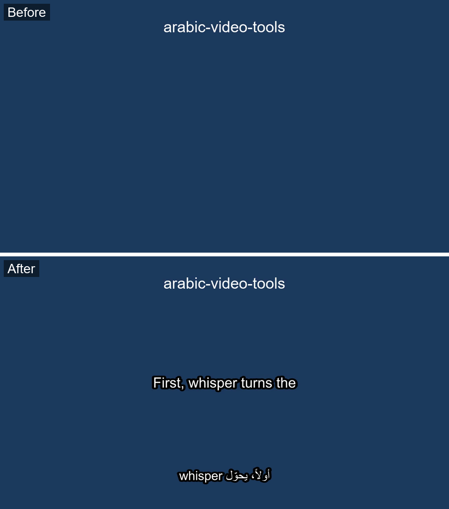

# arabic-video-tools

[العربي](#العربي) | [English](#english)

---

## العربي

### 1. شو هاي الأدوات
أدوات صغيرة بـ PowerShell لويندوز، بتحوّل كلام الفيديو لنص، وبتحرق الترجمة على الفيديو. والترجمة العربية بتطلع صح: الحروف متصلة، والسطر من اليمين لليسار.
- كل إشي بيشتغل على جهازك، بدون إنترنت وبدون اشتراك، ومجاني.
- كل أداة بتعمل شغلة وحدة، وبتشتغلهم كلهم من قائمة مرقّمة وحدة.
- كل أداة بتشتغل أول تجربة جافة: بتطبع شو رح تعمل وما بتكتب إشي. بس مع `-Run` بتشتغل فعلاً.
- ما بتحذف ولا بتكتب فوق أي ملف، والفيديو الأصلي ما بيتغيّر.

هاي النسخة الأولى (الطبقة 1): استخراج النص من الفيديو، وحرق الترجمة.

### 2. فيديو قبل وبعد


### 3. التنزيل وفتح PowerShell
1. بصفحة الريبو على GitHub: اكبس على زر Code، وبعدين Download ZIP.
2. فك الضغط بمجلد بتختاره. هاد المجلد هو «مجلد الريبو»، وفيه `video-tools.root` و `tools`.
3. افتح PowerShell، وادخل على المجلد قبل أي أمر بهالصفحة:
   ```
   cd "<مجلد الريبو>"
   ```
   كل الأوامر الجاية بتشتغل من هون.

### 4. شو لازم تركّب
1. Windows 10 أو 11، وفيه Windows PowerShell 5.1 (موجود أصلاً).
2. ffmpeg نسخة full، 9 أو أحدث، لأنه لازم يكون فيه فلتر whisper وفلتر libass:
   ```
   winget install Gyan.FFmpeg
   ```
   تأكد إنه الفلترين موجودين: `ffmpeg -filters` لازم يبيّن فيه `whisper` و `subtitles`.
3. موديل whisper، ملف `ggml-large-v3-turbo-q5_0.bin` (حوالي 547 MB)، من صفحة `ggerganov/whisper.cpp` على Hugging Face:
   https://huggingface.co/ggerganov/whisper.cpp/tree/main
   الملف بيتحط بـ `videos\models\` (شوف التجهيز).

### 5. التجهيز (المجلدات وملف الإعداد)
من مجلد الريبو (المجلد اللي فيه `video-tools.root`)، اعمل المجلدات بأمر واحد:
```
New-Item -ItemType Directory videos\inbox, videos\work, videos\out, videos\done, videos\models
```
- `videos\inbox`: هون بتحط الفيديوهات الجديدة.
- `videos\work`: الصوت والنص (wav و srt).
- `videos\out`: النتائج (القوائم، وملف التسليم، والفيديو مع الترجمة).
- `videos\done`: الفيديوهات اللي خلصت.
- `videos\models`: موديل whisper.

ملف الإعداد اختياري. إذا ما عملته، كل إشي بياخد القيمة الافتراضية، و ffmpeg بيندوّر عليه بالـ PATH.
إذا بدك تغيّر إشي: انسخ `tools\video-config.example.psd1` لـ `tools\video-config.local.psd1` بنفس المجلد، وغيّر بس السطر اللي بدك إياه. مثلاً `FfmpegBin` لمجلد ffmpeg عندك. الملف المحلي ما بيدخل git، وبينقرأ كبيانات بس، يعني ما بيشغّل كود.

### 6. أول تشغيل (القائمة)
أول مرة، بدون `-Run`. هيك القائمة بتسأل نفس الأسئلة، بس بتطبع الأمر وما بتشغّل إشي:
```
powershell -ExecutionPolicy Bypass -File tools\video-menu.ps1
```
لما تتأكد إنه كل إشي مزبوط، نفس الأمر مع `-Run`:
```
powershell -ExecutionPolicy Bypass -File tools\video-menu.ps1 -Run
```
بأول سطر بالقائمة بتشوف `MODE DRY` أو `MODE RUN`.

### 7. الأيقونة
على سطح المكتب: كبسة يمين، وبعدين New > Shortcut، وبالهدف حط (غيّر `<مجلد الريبو>` لمكانه عندك):
```
powershell.exe -ExecutionPolicy Bypass -File "<مجلد الريبو>\tools\video-menu.ps1" -Run
```

### 8. الأدوات واحدة واحدة
بالقائمة (الطبقة 1):
- `1` الخط الكامل على inbox (`video-run`): بيشغّل الخمس مراحل ورا بعض، وبيوقف إذا مرحلة فشلت.
- `8` حرق الترجمة (`video-subs`): بيحرق الـ srt على فيديو واحد، وبيكتب الفيديو الجديد بمجلد جديد `out\subs-...`.
- `9` بينقل فيديو خلص من inbox لـ done.
- `0` خروج.

الخمس مراحل (`video-run` بيشغّلهم، وكل وحدة بتشتغل لحالها كمان):
1. `video-list`: بيقرأ أسماء الفيديوهات بـ inbox.
2. `video-length`: مدة كل فيديو، وإذا فيه صوت (أطول من 15 دقيقة بيطلع `too_long`).
3. `video-audio`: بيطلّع الصوت لملف wav.
4. `video-text`: بيحوّل الصوت لنص srt بـ whisper (اللغة بتنعرف لحالها).
5. `video-handoff`: ملف نص واحد مرتب لكل الفيديوهات، جملة بكل سطر مع الوقت. فيك تلصقه بأي مساعد ذكاء اصطناعي عشان يصحّح ويلخّص.

`video-subs` لحالها:
```
powershell -ExecutionPolicy Bypass -File tools\video-subs.ps1 -Name video-01.mp4 -Lang ar -Position bottom -Run
```
- `-Lang ar` بيحرق `<اسم الفيديو>.ar.srt` من `videos\work`، وبيخلي كل سطر من اليمين لليسار. إذا هالملف مش موجود، بيستعمل الـ srt العادي وبيطبع تحذير أصفر.
- `-Position` بيقبل bottom أو middle أو top، و `-FontSize` و `-MarginV` و `-MaxWords` بيتحكموا بالحجم والمكان وعدد الكلمات بكل قطعة.

ترجمة عربية لفيديو بلغة تانية:
1. شغّل الخط الكامل (خيار 1)، فبيطلع `videos\work\<اسم الفيديو>.srt`.
2. خلّي أي مساعد ذكاء اصطناعي يترجم هالملف للعربي، بنفس الأرقام والأوقات، وأسماء البرامج تضل بالإنجليزي.
3. احفظ الترجمة جنبه بـ `videos\work` باسم `<اسم الفيديو>.ar.srt`، مثلاً `video-01.mp4.ar.srt`.
4. احرقها بخيار 8، وجاوب y على `Arabic captions (-Lang ar)?`.

وإذا الفيديو أصلاً بالعربي، `-Lang ar` لحاله بيكفي: الـ srt العادي عربي أصلاً.

### 9. الخصوصية
- كل الشغل على جهازك. ما في إنترنت، ولا حساب، ولا إرسال لأي مكان.
- الإنترنت بيلزم بس لتركيب ffmpeg وتنزيل الموديل مرة وحدة.
- الفيديوهات والنصوص بتضل بمجلد `videos`، وهو مش داخل git.

### 10. مشاكل معروفة
- العربي بنافذة PowerShell بيبيّن مقلوب. هاد عرض بس، وبالفيديو وبالملفات صح.
- whisper أحياناً بيكتب الكلمات الإنجليزية التقنية غلط بالكلام العربي، فراجع النص قبل ما تحرقه.
- whisper ممكن يخترع نص بالسكوت أو بآخر الفيديو. ملف التسليم بيعلّم هالجمل بـ `[?]`، وما بيشيل إشي.
- فلتر whisper ما بيقبل حرف القرص (C:) بالمسار، فالموديل لازم يكون جوا مجلد `videos`.
- إذا ffmpeg جاي من الـ PATH، بيطلع تحذير أصفر. هاد طبيعي، بس تأكد إنه فيه whisper و libass، أو حط `FfmpegBin` بملف الإعداد.

### 11. الرخصة
MIT. شوف ملف [LICENSE](LICENSE).

---

## English

### 1. What it does
Small PowerShell tools for Windows that turn the speech in a video into text and burn captions onto the video. Arabic captions come out right: joined letters, and each line right to left.
- Everything runs on your machine: no internet, no account, free.
- Each tool does one job, and one numbered menu runs them all.
- Each tool starts as a dry run: it prints what it would do and writes nothing. Only with `-Run` does it really work.
- Nothing is ever deleted or overwritten, and the original video never changes.

This first version (layer 1): text from the video, and burned captions.

### 2. Before and after


### 3. Download and open PowerShell
1. On the repo page on GitHub: click the Code button, then Download ZIP.
2. Unzip it into a folder you choose. That folder is the "repo folder": it has `video-tools.root` and `tools`.
3. Open PowerShell and go into that folder before any command on this page:
   ```
   cd "<repo folder>"
   ```
   All the commands below run from there.

### 4. Requirements
1. Windows 10 or 11, with Windows PowerShell 5.1 (already there).
2. ffmpeg, a full build, version 9 or newer, because it needs the whisper filter and libass:
   ```
   winget install Gyan.FFmpeg
   ```
   Check both filters: `ffmpeg -filters` must list `whisper` and `subtitles`.
3. The whisper model `ggml-large-v3-turbo-q5_0.bin` (about 547 MB), from the `ggerganov/whisper.cpp` page on Hugging Face:
   https://huggingface.co/ggerganov/whisper.cpp/tree/main
   It goes in `videos\models\` (see Setup).

### 5. Setup
From the repo folder (the one with `video-tools.root`), make the folders with one command:
```
New-Item -ItemType Directory videos\inbox, videos\work, videos\out, videos\done, videos\models
```
- `videos\inbox`: put new videos here.
- `videos\work`: audio and text (wav and srt).
- `videos\out`: results (lists, the handoff file, the captioned video).
- `videos\done`: finished videos.
- `videos\models`: the whisper model.

The settings file is optional. Without it every value takes its default, and ffmpeg is looked for on PATH.
To change something: copy `tools\video-config.example.psd1` to `tools\video-config.local.psd1` in the same folder and set only the lines you need, for example `FfmpegBin` to your ffmpeg folder. The local file stays out of git and is read as data only, so it never runs code.

### 6. First run
The first time, without `-Run`. The menu asks the same questions but only prints the command:
```
powershell -ExecutionPolicy Bypass -File tools\video-menu.ps1
```
When all looks right, the same command with `-Run`:
```
powershell -ExecutionPolicy Bypass -File tools\video-menu.ps1 -Run
```
The first line of the menu shows `MODE DRY` or `MODE RUN`.

### 7. Desktop icon
On the desktop: right click, New > Shortcut, and as the target (change `<repo folder>` to where it is on your machine):
```
powershell.exe -ExecutionPolicy Bypass -File "<repo folder>\tools\video-menu.ps1" -Run
```

### 8. Tools
In the menu (layer 1):
- `1` Full pipeline on inbox (`video-run`): runs the five stages in order and stops if one fails.
- `8` Burn captions (`video-subs`): burns the srt onto one video and writes the new video in a new `out\subs-...` folder.
- `9` Moves a finished video from inbox to done.
- `0` Exit.

The five stages (`video-run` runs them, and each one also runs alone):
1. `video-list`: reads the video names in inbox.
2. `video-length`: the length of each video and whether it has audio (over 15 minutes is `too_long`).
3. `video-audio`: pulls the audio into a wav file.
4. `video-text`: turns the audio into srt text with whisper (the language is found by itself).
5. `video-handoff`: one tidy text file for all the videos, one sentence per line with its time. You can paste it into any AI assistant to fix and sum it up.

`video-subs` alone:
```
powershell -ExecutionPolicy Bypass -File tools\video-subs.ps1 -Name video-01.mp4 -Lang ar -Position bottom -Run
```
- `-Lang ar` burns `<video name>.ar.srt` from `videos\work` and makes each line right to left. If that file is not there, it uses the normal srt and prints a yellow warning.
- `-Position` takes bottom, middle or top, and `-FontSize`, `-MarginV` and `-MaxWords` set the size, the place and the words in each piece.

Arabic captions for a video in another language:
1. Run the full pipeline (option 1), which writes `videos\work\<video name>.srt`.
2. Ask any AI assistant to translate that file to Arabic, with the same numbers and times, and program names kept in English.
3. Save the translation next to it in `videos\work` as `<video name>.ar.srt`, for example `video-01.mp4.ar.srt`.
4. Burn it with option 8, and answer y to `Arabic captions (-Lang ar)?`.

If the video is already in Arabic, `-Lang ar` alone is enough: the normal srt is already Arabic.

### 9. Privacy
- All the work happens on your machine. No internet, no account, nothing is sent anywhere.
- The internet is needed only once, to install ffmpeg and download the model.
- Videos and text stay in the `videos` folder, which is not in git.

### 10. Known issues
- Arabic in the PowerShell window shows reversed. That is the display only: the video and the files are right.
- whisper sometimes misspells English technical words in Arabic speech, so check the text before you burn it.
- whisper can invent text in silence or at the end of a video. The handoff file marks those lines with `[?]` and removes nothing.
- The whisper filter does not accept a drive letter (C:) in a path, so the model must be inside the `videos` folder.
- When ffmpeg comes from PATH you get a yellow warning. That is normal, but check it has whisper and libass, or set `FfmpegBin` in the settings file.

### 11. License
MIT. See [LICENSE](LICENSE).
